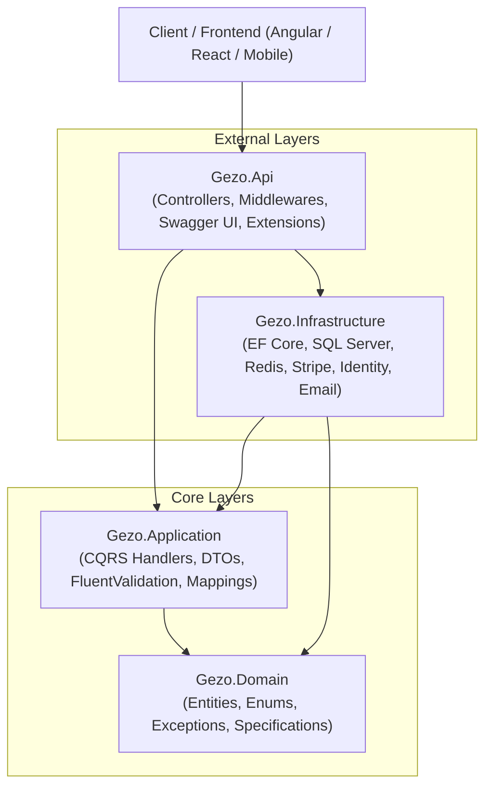

# 🛒 Gezo Store - Enterprise E-Commerce Backend API

[](https://dotnet.microsoft.com/)
[](https://docs.microsoft.com/en-us/dotnet/csharp/)
[](https://learn.microsoft.com/en-us/ef/core/)
[](https://redis.io/)
[](https://stripe.com/)
[](https://swagger.io/)

A modern, highly-scalable, production-grade E-Commerce Web API built with **.NET 10**, following **Clean Architecture**, **CQRS (Command Query Responsibility Segregation)**, and **Domain-Driven Design (DDD)** principles.

---

## 🏛️ Architecture Overview

The solution adheres strictly to **Clean Architecture (Onion Architecture)** to ensure loose coupling, high maintainability, and testability:



### 📁 Project Structure

```text
backend/
├── Gezo.Api/
│   ├── Gezo.Domain/              # Core business entities, enums, exceptions & specifications
│   │   ├── Entities/             # Product, Order, OrderItem, Review, WishlistItem, etc.
│   │   ├── Enums/                # OrderStatus, PaymentStatus, PaymentMethod, etc.
│   │   └── Exceptions/           # Custom domain exceptions (NotFound, BadRequest, etc.)
│   │
│   ├── Gezo.Application/         # Business logic layer (CQRS with MediatR)
│   │   ├── Features/             # Organized by feature (Products, Basket, Orders, Payments, etc.)
│   │   │   ├── Accounts/         # Authentication & Authorization (Commands, Queries, DTOs)
│   │   │   ├── Basket/           # Redis-backed shopping cart operations
│   │   │   ├── Orders/           # Order creation, stock deduction, admin controls
│   │   │   ├── Payments/         # Stripe integration & Webhook processing
│   │   │   ├── Products/         # Product management with images & filters
│   │   │   ├── Reviews/          # Customer reviews & ratings
│   │   │   └── Wishlist/         # Customer favorites/wishlists
│   │   ├── Common/               # Global mappings (AutoMapper), behaviors & responses
│   │   └── Interfaces/           # Repositories & service contracts
│   │
│   ├── Gezo.Infrastructure/      # Data access, external services & persistence
│   │   ├── Persistence/          # StoreDbContext, EF Migrations & Database Seeder
│   │   ├── Repositories/         # Generic Repository & Unit of Work implementation
│   │   ├── Services/             # StripePaymentService, BasketService (Redis), EmailService
│   │   └── Specifications/       # SpecificationEvaluator for dynamic EF Core queries
│   │
│   └── Gezo.Api/                 # Presentation layer (REST Controllers)
│       ├── Controllers/          # Auth, Products, Basket, Orders, Payments, etc.
│       ├── MiddleWare/           # Global exception handler middleware
│       └── Extensions/           # Swagger & JWT authentication configuration
```

---

## ✨ Key Features

### 🔐 1. Authentication & Security
- **ASP.NET Core Identity**: User registration, login, role management (`Admin`, `Customer`).
- **JWT (JSON Web Tokens)**: Secure stateless authentication with Access Tokens.
- **Refresh Token Rotation**: Automatic token refresh mechanism stored securely in SQL Server.
- **Email Verification & Password Reset**: SMTP integration (Mailtrap) with HTML email templates and secure tokens.

### 🛍️ 2. Catalog & Product Management
- Full CRUD for **Products**, **Brands**, and **Categories**.
- Multi-image support per product with primary image designation and display ordering.
- Dynamic filtering, sorting, and pagination via the **Specification Pattern**.
- Automatic SKU and slug generation.

### 🛒 3. High-Performance Basket (Redis)
- In-memory cart storage powered by **StackExchange.Redis**.
- Lightning-fast item addition, quantity updates, and deletion.
- Transient cart lifecycle decoupled from relational database writes.

### 📦 4. Order Processing & Inventory Control
- Seamless conversion of Redis basket into verified orders.
- **Real-time stock deduction**: Prevents overselling by validating and decrementing `StockQuantity` inside a Unit of Work transaction.
- Delivery method selection with dynamic shipping fee calculation.
- User order history and detailed order tracking.
- Admin dashboard endpoints for order status transitions (`Pending` ➡️ `PaymentReceived` ➡️ `Shipped` ➡️ `Delivered` ➡️ `Cancelled`).

### 💳 5. Online Payments (Stripe)
- **Stripe PaymentIntent API**: Secure server-to-server payment lifecycle.
- **Stripe Webhooks**: Asynchronous payment confirmation with cryptographically verified digital signatures (`Stripe-Signature`).
- Automatic order status updates upon payment success or failure.
- Multiple payment methods: **Online Payment** (Credit/Debit Cards) and **Cash on Delivery (COD)**.

### ⭐ 6. Reviews, Wishlist & Addresses
- **Reviews**: Customer star ratings (1 to 5) with feedback comments per product.
- **Wishlist**: Saved items for authenticated users.
- **Address Book**: User profile shipping address storage and updates.

### 🛡️ 7. Reliability & API Standards
- **Unified Response Envelope**: Every endpoint returns a consistent `ApiResponse<T>` with HTTP status code, data payload, and error messages.
- **Global Exception Handling Middleware**: Intercepts unhandled exceptions and domain errors seamlessly.
- **FluentValidation**: Automatic request validation via MediatR Pipeline Behavior.
- **Swagger Documentation**: Interactive OpenAPI UI with built-in **JWT Bearer Authorization** button.

---

## 🛠️ Tech Stack & Design Patterns

| Layer / Concern | Technologies & Patterns |
| :--- | :--- |
| **Framework** | .NET 10.0 (C# 13) |
| **Architecture** | Clean Architecture (Onion), CQRS |
| **Mediation & Messaging**| MediatR 11 (Commands, Queries, Pipeline Behaviors) |
| **Database & ORM** | Microsoft SQL Server, Entity Framework Core 10 |
| **In-Memory Cache** | Redis (StackExchange.Redis) |
| **Security & Auth** | ASP.NET Core Identity, JWT Bearer, Refresh Tokens |
| **Payment Gateway** | Stripe.net SDK (PaymentIntents & Webhooks) |
| **Validation** | FluentValidation |
| **Object Mapping** | AutoMapper |
| **Email Service** | SMTP / Mailtrap |
| **Patterns** | Repository Pattern, Unit of Work, Specification Pattern, Options Pattern |
| **API Documentation** | Swashbuckle Swagger UI (with JWT Bearer Support) |

---

## 🚀 Getting Started

### Prerequisites
- [.NET 10.0 SDK](https://dotnet.microsoft.com/download)
- [SQL Server](https://www.microsoft.com/en-us/sql-server) (Local or Cloud)
- [Redis Server](https://redis.io/downloads/) (Local or Docker)
- [Stripe Account](https://stripe.com) (for test API keys)

### 1. Clone the Repository
```bash
git clone https://github.com/your-username/gezo-store-backend.git
cd gezo-store-backend
```

### 2. Configure `appsettings.json`
Update `Gezo.Api/Gezo.Api/appsettings.json` (or use .NET User Secrets):

```json
{
  "ConnectionStrings": {
    "myConnection": "Server=YOUR_SERVER;Database=GezoStoreDb;Trusted_Connection=True;TrustServerCertificate=True;",
    "Redis": "localhost:6379"
  },
  "JwtSettings": {
    "SecretKey": "YOUR_STRONG_JWT_SECRET_KEY_HERE_MIN_32_CHARS",
    "Issuer": "GezoStore",
    "Audience": "GezoStoreUsers",
    "ExpiryInMinutes": 60,
    "RefreshTokenExpiryInDays": 7
  },
  "Stripe": {
    "PublishableKey": "pk_test_...",
    "SecretKey": "sk_test_...",
    "WebhookSecret": "whsec_..."
  },
  "EmailSettings": {
    "Host": "sandbox.smtp.mailtrap.io",
    "Port": 587,
    "Username": "YOUR_SMTP_USER",
    "Password": "YOUR_SMTP_PASSWORD",
    "FromEmail": "no-reply@gezostore.com",
    "FromName": "Gezo Store"
  }
}
```

### 3. Run Database Migrations
```bash
dotnet ef database update --project Gezo.Api/Gezo.Infrastructure --startup-project Gezo.Api/Gezo.Api
```

### 4. Run the API
```bash
dotnet run --project Gezo.Api/Gezo.Api/Gezo.Api.csproj
```

The application will start, seed initial data automatically (Roles, Delivery Methods, Categories, Brands, Products), and be accessible at:
- **Swagger UI**: `http://localhost:5289/swagger`
- **Root URL**: Redirects automatically to `/swagger`

---

## 📡 API Endpoints Summary

### 🔑 Authentication (`/api/Account`)
| Method | Endpoint | Description | Auth |
| :--- | :--- | :--- | :--- |
| `POST` | `/api/Account/register` | Register new customer | Anonymous |
| `POST` | `/api/Account/login` | Login and receive JWT + Refresh Token | Anonymous |
| `POST` | `/api/Account/refresh-token` | Renew expired Access Token | Anonymous |
| `POST` | `/api/Account/confirm-email` | Confirm account via email link | Anonymous |
| `POST` | `/api/Account/forgot-password`| Send password reset email | Anonymous |
| `POST` | `/api/Account/reset-password` | Reset password using reset token | Anonymous |

### 📦 Products & Catalog (`/api/Product`, `/api/Brand`, `/api/Category`)
| Method | Endpoint | Description | Auth |
| :--- | :--- | :--- | :--- |
| `GET` | `/api/Product` | Get all products (Filters, Sort, Pagination) | Anonymous |
| `GET` | `/api/Product/{id}` | Get product details by ID | Anonymous |
| `POST` | `/api/Product` | Create new product with image uploads | `Admin` |
| `PUT` | `/api/Product/{id}` | Update product | `Admin` |
| `DELETE`| `/api/Product/{id}` | Delete product | `Admin` |
| `GET` | `/api/Brand` | Get all brands | Anonymous |
| `GET` | `/api/Category` | Get all categories | Anonymous |

### 🛒 Basket (`/api/Basket`)
| Method | Endpoint | Description | Auth |
| :--- | :--- | :--- | :--- |
| `GET` | `/api/Basket` | Get current user's basket (Redis) | Authorize |
| `POST` | `/api/Basket` | Add or update items in basket | Authorize |
| `DELETE`| `/api/Basket` | Clear current user's basket | Authorize |

### 📑 Orders (`/api/Order`)
| Method | Endpoint | Description | Auth |
| :--- | :--- | :--- | :--- |
| `POST` | `/api/Order` | Create order from basket with stock deduction | Authorize |
| `GET` | `/api/Order` | Get order history of current user | Authorize |
| `GET` | `/api/Order/{id}` | Get specific order details | Authorize |
| `GET` | `/api/Order/delivery-methods` | List available delivery methods and fees | Anonymous |
| `GET` | `/api/Order/admin/GetAllOrders`| Get all orders with pagination & filters | `Admin` |
| `PUT` | `/api/Order/admin/{id}/status`| Update order status (Shipped, Delivered) | `Admin` |

### 💳 Payments (`/api/Payment`)
| Method | Endpoint | Description | Auth |
| :--- | :--- | :--- | :--- |
| `POST` | `/api/Payment/{orderId}` | Create or retrieve Stripe PaymentIntent | Authorize |
| `POST` | `/api/Payment/webhook` | Process Stripe Webhook events | Anonymous |
| `GET` | `/api/Payment/{orderId}/status`| Get payment status for order | Authorize |

### ⭐ Reviews & Wishlist
| Method | Endpoint | Description | Auth |
| :--- | :--- | :--- | :--- |
| `GET` | `/api/Product/{productId}/reviews` | Get reviews for a product | Anonymous |
| `POST` | `/api/Product/{productId}/reviews` | Add star rating & review comment | Authorize |
| `GET` | `/api/Wishlist` | Get user's wishlist | Authorize |
| `POST` | `/api/Wishlist/{productId}` | Add product to wishlist | Authorize |
| `DELETE`| `/api/Wishlist/{productId}` | Remove product from wishlist | Authorize |

### 📍 Address (`/api/Address`)
| Method | Endpoint | Description | Auth |
| :--- | :--- | :--- | :--- |
| `GET` | `/api/Address` | Get customer profile address | Authorize |
| `POST` | `/api/Address` | Add shipping address | Authorize |
| `PUT` | `/api/Address` | Update shipping address | Authorize |

---

## 👨‍💻 Author
**Kareem ElGazery**  
*Full Stack / .NET Backend Developer*

