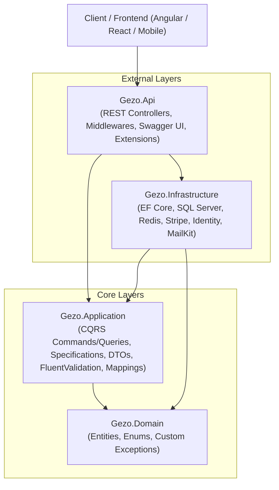

# 🛒 Gezo Store - Enterprise E-Commerce Backend API

[](https://dotnet.microsoft.com/)
[](https://docs.microsoft.com/en-us/dotnet/csharp/)
[](https://learn.microsoft.com/en-us/ef/core/)
[](https://redis.io/)
[](https://stripe.com/)
[](https://swagger.io/)

A modern, highly-scalable, production-grade E-Commerce Web API built with **.NET 10**, following **Clean Architecture (Onion Architecture)**, **CQRS (Command Query Responsibility Segregation)** with MediatR, and a **Feature-Based Modular Organization**.

---

## 🏛️ Architecture Overview

The solution adheres strictly to **Clean Architecture** to ensure loose coupling, high testability, and separation of concerns:



### 📁 Project Structure

```text
backend/Gezo.Api/
├── Gezo.Domain/                  # Core business entities, enums & domain exceptions
│   ├── Entities/                 # Product, Order, OrderItem, Review, WishlistItem, etc.
│   ├── Enums/                    # OrderStatus, PaymentStatus, PaymentMethod, etc.
│   └── Exceptions/               # Custom domain exceptions (NotFound, BadRequest, etc.)
│
├── Gezo.Application/             # Business logic layer (CQRS with MediatR)
│   ├── Features/                 # Organized by feature (10 vertical modules)
│   │   ├── Accounts/             # Authentication & User Management (Commands, Queries, DTOs)
│   │   ├── Addresses/            # User shipping address management
│   │   ├── Basket/               # Redis-backed shopping cart operations
│   │   ├── Brands/               # Brand management & queries
│   │   ├── Categories/           # Category management & queries
│   │   ├── Orders/               # Order creation, inventory deduction, admin management
│   │   ├── Payments/             # Stripe payment intents & webhook processing
│   │   ├── Products/             # Catalog management, filtering, search, image handling
│   │   ├── Reviews/              # Product reviews & rating submissions
│   │   └── Wishlist/             # Customer favorites/wishlists
│   ├── Behaviors/                # MediatR Pipeline Behaviors (ValidationBehavior via FluentValidation)
│   ├── Common/                   # AutoMapper profiles, unified ApiResponse envelopes, settings
│   ├── Interfaces/               # Repositories & infrastructure service contracts
│   └── Specifications/           # BaseSpecification & feature-specific dynamic queries
│
├── Gezo.Infrastructure/          # Data access, external services & persistence
│   ├── Persistence/              # StoreDbContext, EF Migrations & Database Seeders
│   ├── Repositories/             # Generic Repository & Unit of Work implementation
│   ├── Services/                 # StripePaymentService, BasketService (Redis), EmailService (MailKit), ImageService
│   └── SpecificationEvaluator/   # Dynamic EF Core query evaluation
│
└── Gezo.Api/                     # Presentation layer (RESTful Controllers)
    ├── Controllers/              # 10 Controllers with 45 RESTful endpoints
    ├── Extensions/               # Swagger & JWT authentication configuration
    ├── MiddleWare/               # Global exception handler middleware
    └── wwwroot/                  # Static file hosting for uploaded product images
```

---

## ✨ Key Features

### 🔐 1. Authentication & Security
- **ASP.NET Core Identity**: User registration, login, role-based access control (`Admin`, `Customer`).
- **JWT (JSON Web Tokens)**: Stateless access token authentication.
- **Refresh Token Rotation**: Automatic token refresh mechanism persisted in SQL Server / secure cookies.
- **Email Verification & Password Reset**: Asynchronous email delivery using **MailKit / MimeKit** (SMTP / Mailtrap) with secure reset tokens.
- **User Account Management**: Current user profile retrieval (`/api/Account/Me`), password changes, and logout.

### 🛍️ 2. Catalog & Product Management
- Full CRUD for **Products**, **Brands**, and **Categories**.
- Multi-image support per product with local storage handling (`IImageService`), size validation (5MB max), and extension validation (`.jpg`, `.jpeg`, `.png`, `.webp`).
- Dynamic search, filtering, multi-field sorting, and pagination via the **Specification Pattern**.
- Automatic SKU and slug assignment.

### 🛒 3. High-Performance Basket (Redis)
- In-memory cart storage powered by **StackExchange.Redis**.
- Ultra-low latency cart operations (sub-5ms) decoupled from relational database writes.
- Operations: retrieve cart, update/add items, delete single item, and clear cart.

### 📦 4. Order Processing & Inventory Control
- Seamless conversion of Redis cart items into verified persistent orders.
- **Real-Time Stock Deduction**: Validates stock availability and decrements `StockQuantity` inside a **Unit of Work transaction** to ensure data consistency and prevent overselling.
- Delivery method selection with dynamic shipping fee calculation.
- User order history and order details tracking.
- Admin dashboard endpoints for order management and status transitions (`Pending` ➡️ `PaymentReceived` ➡️ `Shipped` ➡️ `Delivered` ➡️ `Cancelled`).

### 💳 5. Online Payments (Stripe)
- **Stripe PaymentIntent API**: Secure server-to-server payment initialization and state verification.
- **Stripe Webhooks**: Asynchronous event processing with cryptographic signature verification (`Stripe-Signature` via HMAC SHA-256).
- Supports both **Online Card Payment** and **Cash on Delivery (COD)**.

### ⭐ 6. Customer Engagement (Reviews, Wishlist & Addresses)
- **Product Reviews**: 1-to-5 star customer ratings and written feedback per product.
- **Wishlist**: Per-user saved items with quick add/remove.
- **Address Book**: Stored shipping profile per customer with automatic mapping into checkout orders.

### 🛡️ 7. Reliability & API Standards
- **Unified Response Envelope**: Standardized `ApiResponse<T>` with HTTP status code, data payload, and error messages.
- **Global Exception Handling Middleware**: Intercepts domain and unhandled exceptions, returning standard RFC responses.
- **Pipeline Validation**: MediatR `ValidationBehavior` running **FluentValidation** on every incoming command/query before reaching handlers.
- **Swagger / OpenAPI**: Complete interactive documentation with built-in JWT Bearer authorization support.

---

## 🛠️ Tech Stack & Design Patterns

| Layer / Concern | Technologies & Patterns |
| :--- | :--- |
| **Framework** | .NET 10.0 (C# 13) |
| **Architecture** | Clean Architecture (Onion Architecture), Vertical Feature Folders |
| **Mediation & Messaging**| MediatR 11 (Commands, Queries, Pipeline Behaviors) |
| **Database & ORM** | Microsoft SQL Server, Entity Framework Core 10 |
| **In-Memory Cache** | Redis (StackExchange.Redis) |
| **Security & Auth** | ASP.NET Core Identity, JWT Bearer Tokens, Refresh Token Rotation |
| **Payment Gateway** | Stripe.net SDK (PaymentIntents & Webhooks) |
| **Validation** | FluentValidation (via MediatR Pipeline Behavior) |
| **Object Mapping** | AutoMapper |
| **Email Service** | MailKit & MimeKit (SMTP / Mailtrap) |
| **File Storage** | Local static files (`wwwroot/uploads/products`) via `IImageService` |
| **Patterns** | Generic Repository, Unit of Work, Specification Pattern, Options Pattern, Envelope Pattern |
| **API Documentation** | Swashbuckle Swagger UI (OpenAPI with JWT Bearer support) |

---

## 🚀 Getting Started

### Prerequisites
- [.NET 10.0 SDK](https://dotnet.microsoft.com/download)
- [SQL Server](https://www.microsoft.com/en-us/sql-server) (Local or Cloud)
- [Redis Server](https://redis.io/downloads/) (Local or Docker)
- [Stripe Account](https://stripe.com) (for test API keys)

### 1. Clone the Repository
```bash
git clone https://github.com/ElGazery/gezo-store-backend.git
cd gezo-store-backend
```

### 2. Configure `appsettings.json`
Update `backend/Gezo.Api/Gezo.Api/appsettings.json` (or use .NET User Secrets):

```json
{
  "ConnectionStrings": {
    "myConnection": "Server=YOUR_SERVER;Database=GezoStoreDb;Trusted_Connection=True;TrustServerCertificate=True;",
    "Redis": "localhost:6379"
  },
  "JwtSettings": {
    "SecretKey": "YOUR_STRONG_JWT_SECRET_KEY_HERE_MIN_32_CHARS",
    "Issuer": "GezoStore",
    "Audience": "GezoStoreUsers",
    "ExpiryInMinutes": 60,
    "RefreshTokenExpiryInDays": 7
  },
  "Stripe": {
    "SecretKey": "sk_test_..."
  },
  "EmailSettings": {
    "Host": "sandbox.smtp.mailtrap.io",
    "Port": 587,
    "Username": "YOUR_SMTP_USER",
    "Password": "YOUR_SMTP_PASSWORD",
    "FromEmail": "no-reply@gezostore.com",
    "FromName": "Gezo Store"
  },
  "FrontendSettings": {
    "BaseUrl": "http://localhost:4200"
  }
}
```

### 3. Run Database Migrations & Initial Seeder
The API automatically applies pending EF Core migrations and seeds initial data (Roles, Admin User, Categories, Brands, Products, Product Images) on startup in Development mode.

To manually apply migrations via CLI:
```bash
dotnet ef database update --project backend/Gezo.Api/Gezo.Infrastructure --startup-project backend/Gezo.Api/Gezo.Api
```

### 4. Run the API
```bash
dotnet run --project backend/Gezo.Api/Gezo.Api/Gezo.Api.csproj
```

The application will start and be accessible at:
- **Swagger UI**: `http://localhost:5289/swagger`
- **Root URL**: Redirects automatically to `/swagger`

---

## 📡 API Endpoints Reference (45 Endpoints)

### 🔑 Authentication & Accounts (`/api/Account`)
| Method | Endpoint | Description | Auth |
| :--- | :--- | :--- | :--- |
| `POST` | `/api/Account/Register` | Register a new customer | Anonymous |
| `POST` | `/api/Account/Login` | Authenticate and obtain JWT + Refresh Token | Anonymous |
| `GET` | `/api/Account/Me` | Get current authenticated user profile | `Authorize` |
| `POST` | `/api/Account/RefreshToken` | Renew expired JWT using refresh token cookie/header | `Authorize` |
| `POST` | `/api/Account/confirm-email` | Confirm account email via generated token | Anonymous |
| `POST` | `/api/Account/forget-password` | Send password reset link to user email | Anonymous |
| `POST` | `/api/Account/reset-password` | Reset password using valid reset token | Anonymous |
| `PUT` | `/api/Account/Change-Password` | Change user password | `Authorize` |
| `DELETE`| `/api/Account/Logout` | Revoke refresh token and log user out | Anonymous |

### 📦 Products (`/api/Product`)
| Method | Endpoint | Description | Auth |
| :--- | :--- | :--- | :--- |
| `GET` | `/api/Product/GetProducts` | List products with filtering, sorting, and pagination | Anonymous |
| `GET` | `/api/Product/GetProductById/{id}` | Get product details by ID | Anonymous |
| `POST` | `/api/Product/AddProduct` | Create new product with image uploads (`multipart/form-data`) | `Admin` |
| `PUT` | `/api/Product` | Update existing product details and images | `Admin` |
| `DELETE`| `/api/Product/DeleteProduct` | Delete a product by query parameter `?id={id}` | `Admin` |

### 🏷️ Brands (`/api/Brand`)
| Method | Endpoint | Description | Auth |
| :--- | :--- | :--- | :--- |
| `GET` | `/api/Brand/GetAllBrands` | List all available brands | Anonymous |
| `GET` | `/api/Brand/{id}` | Get brand details by ID | Anonymous |
| `POST` | `/api/Brand` | Create new brand | `Admin` |
| `PUT` | `/api/Brand/{id}` | Update brand by ID | `Admin` |
| `DELETE`| `/api/Brand/{id}` | Delete brand by ID | `Admin` |

### 🗂️ Categories (`/api/Category`)
| Method | Endpoint | Description | Auth |
| :--- | :--- | :--- | :--- |
| `GET` | `/api/Category/GetAllCategories` | List all categories | `Authorize` |
| `GET` | `/api/Category/{id}` | Get category details by ID | `Authorize` |
| `POST` | `/api/Category/AddCategory` | Create new category | `Admin` |
| `PUT` | `/api/Category/{id}` | Update category by ID | `Admin` |
| `DELETE`| `/api/Category/{id}` | Delete category by ID | `Admin` |

### 🛒 Basket (`/api/Basket`)
| Method | Endpoint | Description | Auth |
| :--- | :--- | :--- | :--- |
| `GET` | `/api/Basket` | Retrieve current user/session shopping cart (Redis) | Anonymous |
| `PUT` | `/api/Basket` | Add or update items in the basket | Anonymous |
| `DELETE`| `/api/Basket/deleteItem` | Remove a specific item from the basket | Anonymous |
| `DELETE`| `/api/Basket` | Clear entire shopping basket | Anonymous |

### 📑 Orders (`/api/Order`)
| Method | Endpoint | Description | Auth |
| :--- | :--- | :--- | :--- |
| `POST` | `/api/Order` | Create order from Redis basket with atomic stock deduction | `Authorize` |
| `GET` | `/api/Order` | Retrieve order history for current user | `Authorize` |
| `GET` | `/api/Order/{id}` | Retrieve detailed order by ID | `Authorize` |
| `GET` | `/api/Order/delivery-methods` | List available delivery methods and shipping fees | Anonymous |
| `GET` | `/api/Order/admin/GetAllOrders`| Get all orders with pagination & filters | `Admin` |
| `PUT` | `/api/Order/admin/{id}/status`| Update order status (`Pending`, `Shipped`, `Delivered`, etc.) | `Admin` |

### 💳 Payments (`/api/Payment`)
| Method | Endpoint | Description | Auth |
| :--- | :--- | :--- | :--- |
| `POST` | `/api/Payment/{orderId}` | Create or retrieve Stripe PaymentIntent for order | `Authorize` |
| `POST` | `/api/Payment/webhook` | Process Stripe webhook events (cryptographic signature verified) | Anonymous |
| `GET` | `/api/Payment/{orderId}/status`| Retrieve payment status for order | `Authorize` |

### ⭐ Reviews (`/api/Product/{productId}/reviews`)
| Method | Endpoint | Description | Auth |
| :--- | :--- | :--- | :--- |
| `GET` | `/api/Product/{productId}/reviews` | Get customer reviews and ratings for a product | Anonymous |
| `POST` | `/api/Product/{productId}/reviews` | Add star rating (1-5) and review comment | `Authorize` |

### 💖 Wishlist (`/api/Wishlist`)
| Method | Endpoint | Description | Auth |
| :--- | :--- | :--- | :--- |
| `GET` | `/api/Wishlist` | Retrieve wishlist items for current user | `Authorize` |
| `POST` | `/api/Wishlist/{productId}` | Add product to user wishlist | `Authorize` |
| `DELETE`| `/api/Wishlist/{productId}` | Remove product from user wishlist | `Authorize` |

### 📍 Addresses (`/api/Address`)
| Method | Endpoint | Description | Auth |
| :--- | :--- | :--- | :--- |
| `GET` | `/api/Address` | Retrieve user shipping address profile | `Authorize` |
| `POST` | `/api/Address` | Create shipping address | `Authorize` |
| `PUT` | `/api/Address` | Update shipping address | `Authorize` |

---

## 👨‍💻 Author
**Kareem ElGazery**  
*Full Stack / .NET Backend Developer*  
- GitHub: [@ElGazery](https://github.com/ElGazery)
- Repository: [gezo-store-backend](https://github.com/ElGazery/gezo-store-backend)
